# 📁 WiFile

**Keep the same files on all your PCs. Private, free, one click to set up.**

- Put a file in a shared folder on one PC and it shows up on your other PCs a couple of minutes later.
- Your files go straight from PC to PC through your own private [Tailscale](https://tailscale.com) network. No cloud storage, no company servers holding your stuff.
- Nothing ever gets wiped. A file deleted on one PC gets *moved* to a `todelete` folder on the others.
- You start with one shared folder (`Documents\Shared`). **Drag any folder onto the WiFile window** to share it too.
- Open it from your phone to grab files or send pictures to your PCs.

---

## Contents

1. [What you need](#1-what-you-need)
2. [Download](#2-download)
3. [Install on your first PC](#3-install-on-your-first-pc)
4. [Install on your other PCs](#4-install-on-your-other-pcs)
5. [Pair your PCs](#5-pair-your-pcs)
6. [Check it, then start syncing](#6-check-it-then-start-syncing)
7. [Share more folders (drag and drop)](#7-share-more-folders-drag-and-drop)
8. [The tray icon](#8-the-tray-icon)
9. [Your phone](#9-your-phone)
10. [Three or more PCs](#10-three-or-more-pcs)
11. [How WiFile handles deletes and clashes](#11-how-wifile-handles-deletes-and-clashes)
12. [Troubleshooting](#12-troubleshooting)
13. [Uninstall](#13-uninstall)

---

## 1. What you need

| | |
|---|---|
| 💻 **Windows 10 or 11** | on every PC you want to sync |
| 🌐 **Internet** | for the setup (it downloads Python and Tailscale the first time) |
| 🔑 **A free Tailscale account** | sign in with Google, Microsoft, GitHub or Apple. **Use the same account on every PC and your phone**, because that's what lets them find each other |

You don't need to install anything by hand. The setup does it all.

---

## 2. Download

1. Go to the **[Releases page](../../releases/latest)**.
2. Under **Assets**, click **`WiFile-Setup.bat`** to download it.

That one file is the whole app. Put it on a USB stick or send it to your other PCs, because you'll run the same file on each one.

> **Windows might say "Windows protected your PC."** That happens with any download that isn't from a big company.
> Click **More info**, then **Run anyway**. (Your browser might also ask "Keep this file?". Say **Keep**.)

---

## 3. Install on your first PC

**Double-click `WiFile-Setup.bat`.** A black window opens and walks through 5 steps:

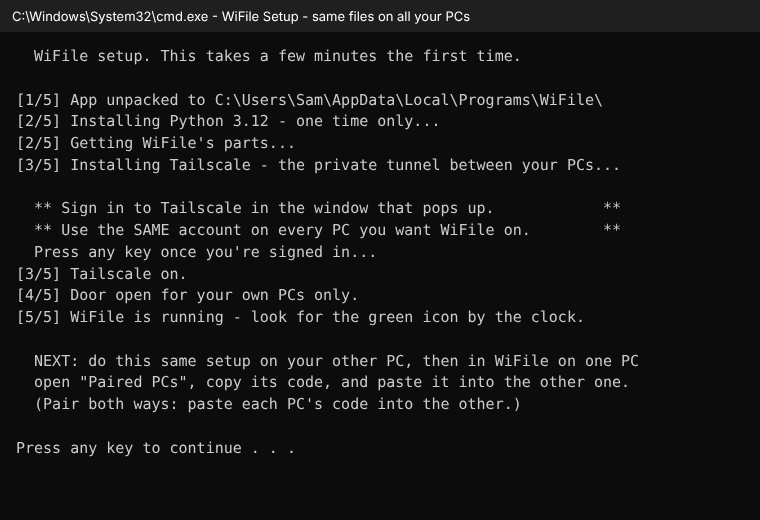

| Step | What happens | What you do |
|---|---|---|
| **1/5** | Unpacks WiFile into `C:\Users\<you>\AppData\Local\Programs\WiFile` | nothing |
| **2/5** | Installs Python 3.12 (first time only) and WiFile's parts | nothing, just wait |
| **3/5** | Installs Tailscale (first time only) | A Tailscale window or web page pops up. **Sign in.** Then come back to the black window and **press any key** |
| **4/5** | Opens WiFile's door, for your own Tailscale devices only | Windows asks *"Do you want to allow this app to make changes?"*. Click **Yes** (one time only) |
| **5/5** | Makes **WiFile** shortcuts on your desktop and Start menu, and starts WiFile | Press any key to close the black window |

WiFile opens its window, and a **round green-and-white icon** shows up by the clock. That's WiFile living in your tray.

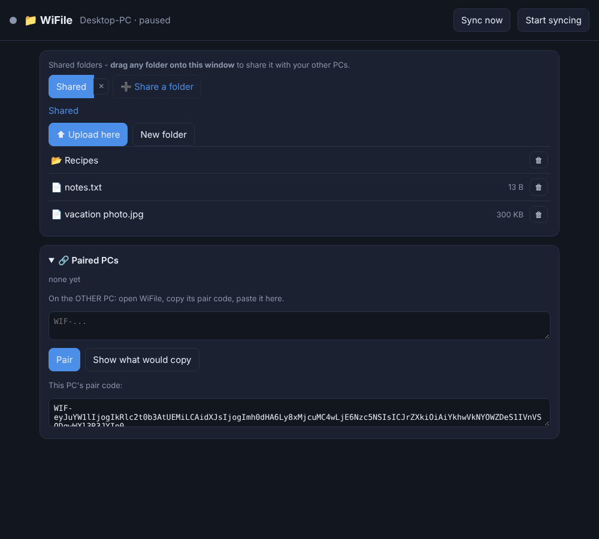

> The dot at the top left is **grey** ("paused") until you pair a PC and hit **Start syncing**. That's normal.

---

## 4. Install on your other PCs

Run the **same `WiFile-Setup.bat`** on every other PC.

⚠️ When Tailscale asks you to sign in, **use the same account** as on the first PC. Different accounts = the PCs can't see each other.

---

## 5. Pair your PCs

Pairing tells two PCs about each other. You do it **once** per pair, **both ways**.

You'll need **both PCs' WiFile windows open**. If a window is closed, click the tray icon (or the **WiFile** desktop shortcut).

**On PC #2 (say your laptop):**

1. Open **🔗 Paired PCs** (click it to open it up).
2. Click inside the box under **"This PC's pair code"**. It selects the whole code. Copy it (**Ctrl+C**).
   *(Or right-click the tray icon, then **Copy pair code**.)*
3. Get that code over to PC #1. Email it to yourself, paste it in a chat, or use a USB stick. It's just text.

**On PC #1 (your desktop):**

4. Open **🔗 Paired PCs**, click in the empty **WIF-...** box, and paste the code (**Ctrl+V**):

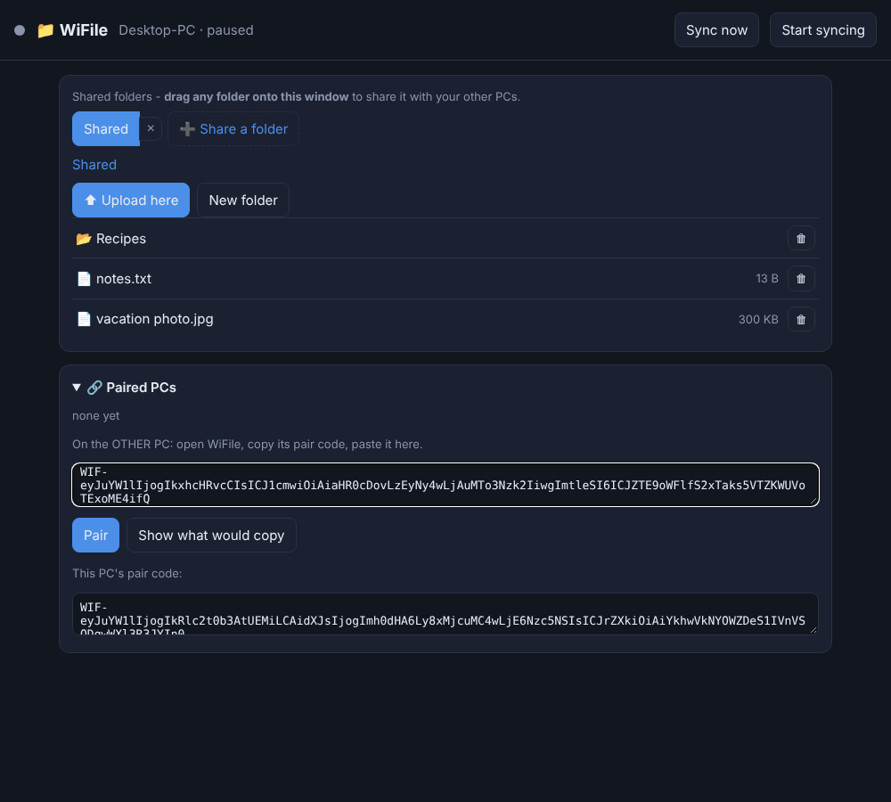

5. Click **Pair**. WiFile calls the other PC to make sure it can reach it. When it works, the PC shows up in the list:

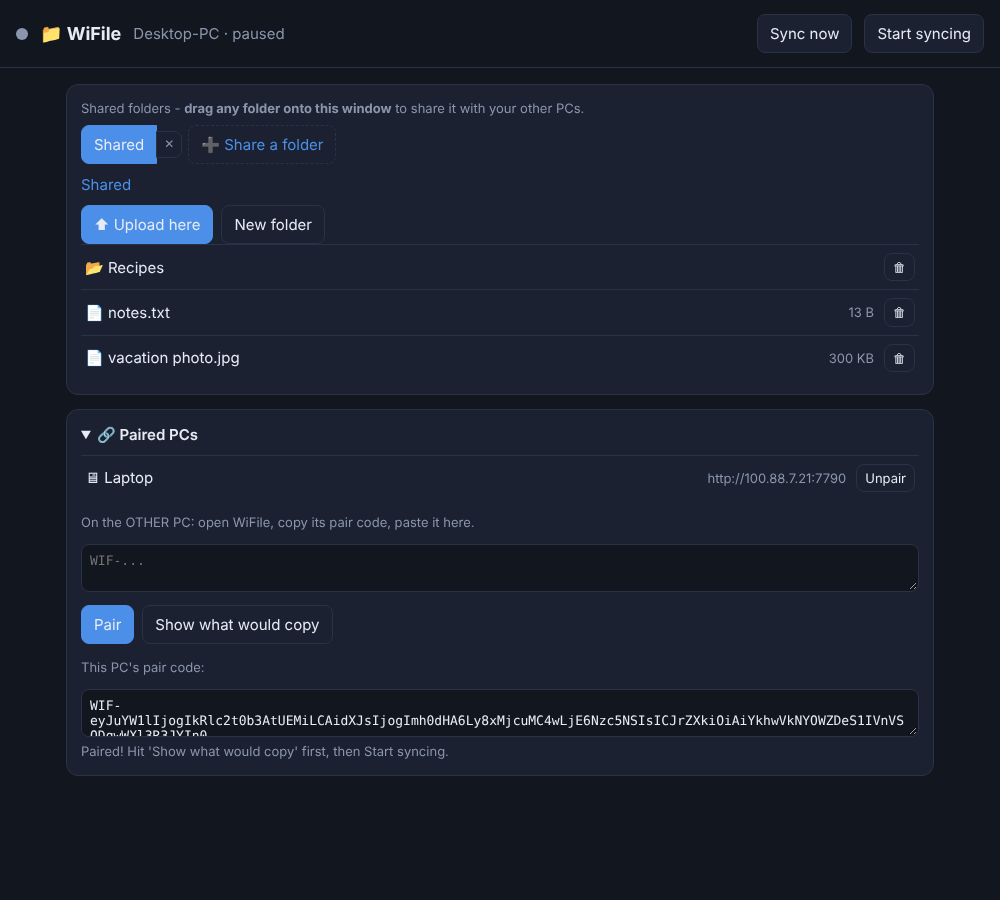

**Now do it the other way:** copy **PC #1's** code (the box at the bottom) and paste it into **PC #2's** WiFile, then click **Pair**.

> Why both ways? Each PC only ever *pulls* new files to itself. Pairing both ways means each one knows to check the other.

---

## 6. Check it, then start syncing

Before anything copies, you can see what *would* happen. Click **Show what would copy**:

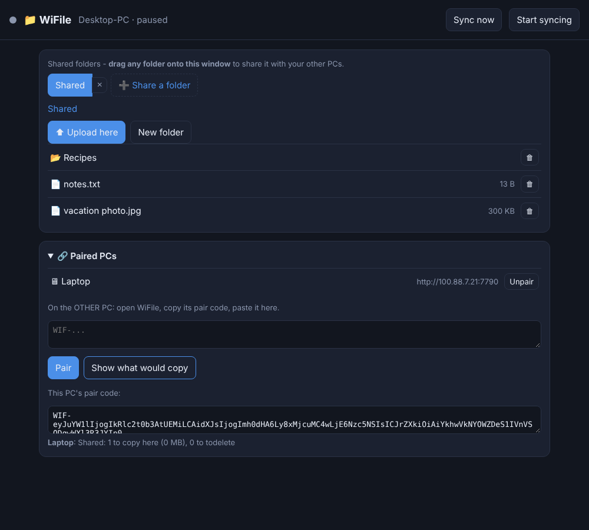

It tells you how many files would come over to this PC, and how many would get moved to `todelete`. On a brand-new setup that last number should be **0**.

Happy with it? Click **Start syncing** at the top right, **on both PCs**.

From now on each PC checks the other **every 2 minutes**. You'll see the dot go **green** with the time of the last check:

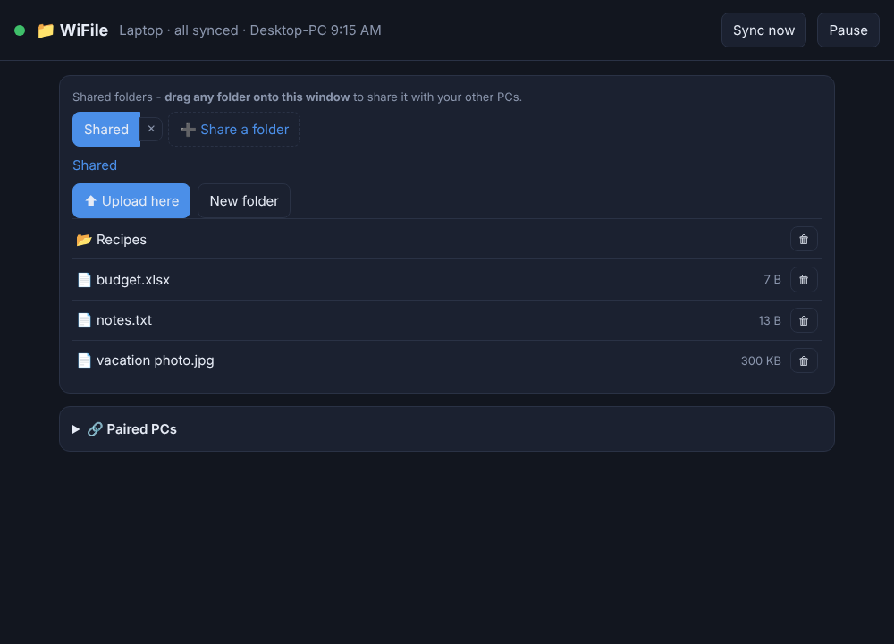

Want it right now? Hit **Sync now**.

---

## 7. Share more folders (drag and drop)

You can share **any folder**: your music, a work folder, your game saves. Just **drag the folder from File Explorer and drop it onto the WiFile window**:

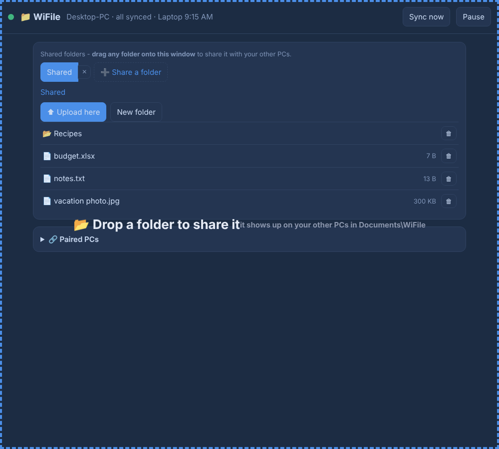

It gets its own tab right away:

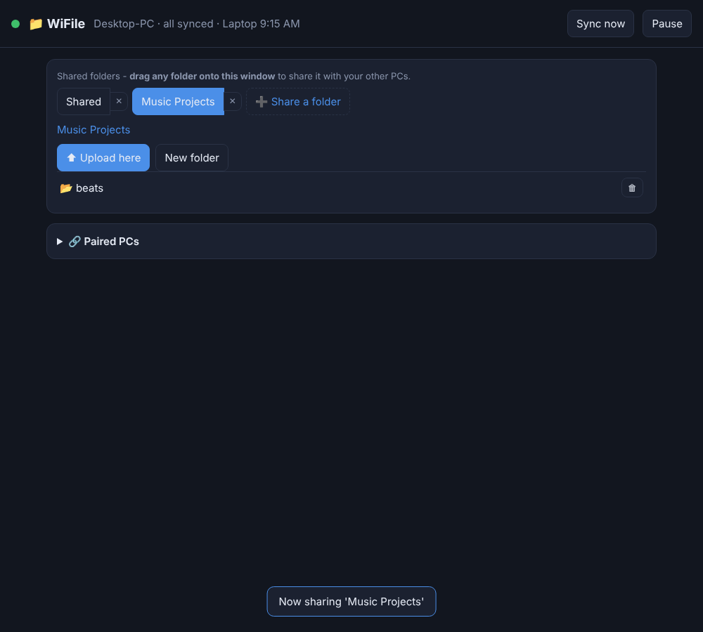

**On your other PCs** it shows up by itself on the next sync, in **`Documents\WiFile\<folder name>`**:

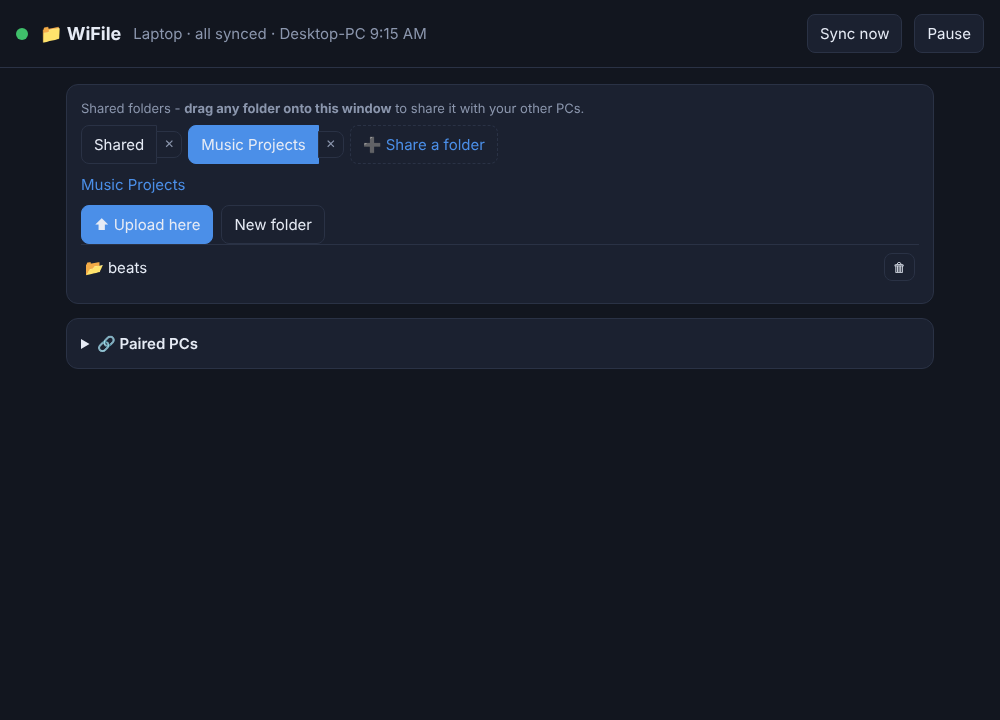

- **Can't drag?** Click **➕ Share a folder** and pick it from the normal Windows folder picker.
- **Stop sharing a folder:** click the **✕** next to its tab. The files stay right where they are. WiFile just stops syncing them.
- WiFile won't share a whole drive (like `C:\`), your whole user folder, or Windows system folders, because that's way too much.
- Files bigger than **4 GB** are skipped.

---

## 8. The tray icon

WiFile lives by the clock. Closing the window just tucks it away, and WiFile keeps syncing. **Right-click** the icon for the menu:

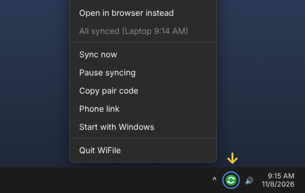

| Menu item | What it does |
|---|---|
| **Open WiFile** | Opens the window (double-clicking the icon does the same) |
| **Open in browser instead** | Opens the same page in your web browser, in case the window acts up |
| **Sync now** | Checks your other PCs right away |
| **Pause / Start syncing** | Stops or starts syncing on this PC |
| **Copy pair code** | Copies this PC's pair code, for pairing a new PC |
| **Phone link** | Opens the link for your phone (see below) |
| **Start with Windows** | Tick it to have WiFile start by itself when you log in. **Off** to start with |
| **Quit WiFile** | Stops WiFile completely. Nothing syncs until you open it again |

**Icon colours:** 🟢 all synced · 🔵 syncing right now · ⚪ paused · 🟠 not paired yet · 🔴 hiccup (hover over it or open the window to see what's up)

---

## 9. Your phone

You can browse your shared folders from your phone, download files, and **upload pictures straight to your PCs**.

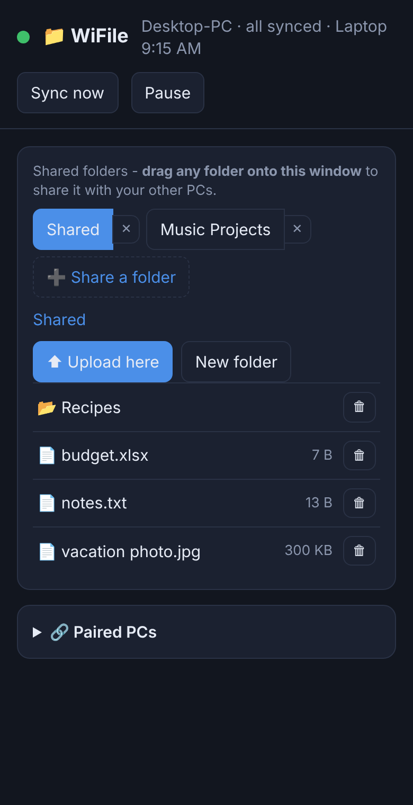

1. Install the **Tailscale** app on your phone ([Android](https://play.google.com/store/apps/details?id=com.tailscale.ipn) / [iPhone](https://apps.apple.com/app/tailscale/id1470499037)) and sign in with **the same account**.
2. On a PC, right-click the WiFile tray icon, then **Phone link**. A little text file opens with your link.
3. Send that link to your phone (email it to yourself, for example) and open it in your phone's browser.
4. Optional: in your browser's menu, pick **Add to Home screen** so it's one tap next time.

> 🔒 **Keep that link private.** The long code on the end of it is the key. Anyone with the link *and* access to your Tailscale network could get in.
>
> The first link in the file (`https://...:8443`) needs Tailscale's **HTTPS certificates** turned on: in the Tailscale admin console, open **DNS** and enable **MagicDNS** and **HTTPS Certificates**. If you don't want to bother, use the **backup link** (`http://100.x.x.x:7790`) from the same file. It works just as well.

Pictures you upload from the phone land in whichever folder you're looking at when you hit **⬆ Upload here**. Then they sync to your other PCs like anything else.

---

## 10. Three or more PCs

Install on each one, then **pair every PC with every other PC** (both ways). That's the fastest.

If you'd rather not: as long as every PC is paired with *at least one* other PC, files still get everywhere. They just hop along, a couple of minutes per hop.

---

## 11. How WiFile handles deletes and clashes

| What happened | What WiFile does |
|---|---|
| You **add or change** a file on one PC | The other PCs copy it over on their next check |
| You **delete** a file on one PC | The other PCs **move** their copy to `Documents\WiFile\todelete\sync trash`. Nothing is ever wiped. Empty that folder yourself when you're sure |
| The **same file got changed on two PCs** before they synced | The newer one wins. The older one is kept next to it, renamed `<name> (conflict <PC name> <date>)` |
| A file is **open / being saved** right then | It's skipped and tried again next check |

WiFile never touches temp files (`.tmp`, `.part`, `.crdownload`...) or `desktop.ini` / `Thumbs.db` junk.

---

## 12. Troubleshooting

| Problem | Fix |
|---|---|
| **"can't reach it ... is it on with WiFile running?"** | The other PC is off, asleep, or WiFile isn't running on it. Turn it on, open WiFile, then **Sync now** |
| **Pairing says it can't reach the other PC** | Both PCs need Tailscale **on** and signed in to the **same account** (check the Tailscale icon by the clock). Also make sure you clicked **Yes** at setup step 4/5. Running `WiFile-Setup.bat` again redoes it |
| **"that code doesn't look right"** | Copy the **whole** code. It starts with `WIF-` and is quite long |
| **"that's THIS PC's code"** | You pasted the code into the same PC it came from. Paste it into the *other* PC |
| **The WiFile window is blank or black** | Right-click the tray icon, then **Open in browser instead**. Everything works there except drag-and-drop (use **➕ Share a folder**) |
| **Windows blocked the download / setup** | Click **More info**, then **Run anyway** (see [Download](#2-download)) |
| **Setup says Python or Tailscale didn't install** | Install it yourself from [python.org](https://www.python.org/downloads/) (3.12, tick *"Add to PATH"*) or [tailscale.com](https://tailscale.com/download), then run `WiFile-Setup.bat` again |
| **A big file never shows up** | Files over 4 GB are skipped on purpose |
| **I want to see what WiFile's been doing** | Look in `AppData\Local\Programs\WiFile\logs\sync.log` |

**Update WiFile:** download the newest `WiFile-Setup.bat` from [Releases](../../releases/latest) and run it. Your pairings and shared folders are kept.

---

## 13. Uninstall

1. Right-click the tray icon, then **Quit WiFile**.
2. Delete the **WiFile** shortcuts on your desktop and in the Start menu.
3. Delete the folder `C:\Users\<you>\AppData\Local\Programs\WiFile` (paste `%LOCALAPPDATA%\Programs` into File Explorer's address bar to find it).
4. Optional: remove the firewall rule. Search Start for **"Windows Defender Firewall with Advanced Security"**, open **Inbound Rules**, and delete **WiFile-Tailscale-7790**.

Your shared files are **not** touched. They stay right where they are.

---

## For tinkerers

```
app/        the app: sync_app.py (tray + window + server), filesync.py (the sync engine), page.html (the window)
installer/  setup_head.bat (the installer) + build_setup.py (packs the app into one WiFile-Setup.bat)
```

Build the one-click installer: `python installer/build_setup.py` (creates `dist/WiFile-Setup.bat`).

How it works: each PC runs a small server on port **7790** that only answers your own Tailscale addresses (and wants the pair key). Every 2 minutes each PC asks its paired PCs for a list of their files, compares it with its own and its records from last time, and pulls over whatever's new. Each PC only ever changes **its own** files, so two PCs never fight over one.
